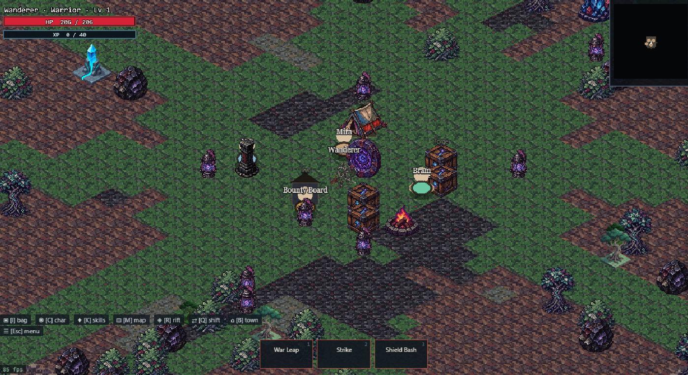
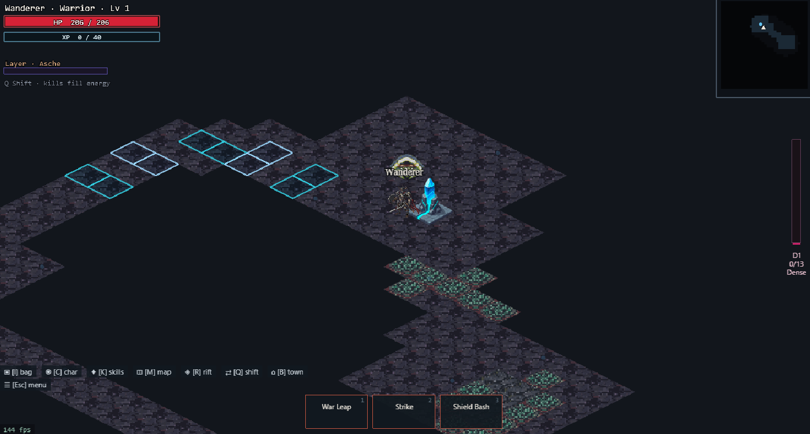

# Riftborn

2.5D isometric hybrid ARPG — Diablo-leaning combat, gathering/crafting, procedural rifts.

**Stack:** Bun · Vite · TypeScript · Phaser 4 · Electron (desktop) · Bun WebSocket (co-op)

## Play

```bash
bun install
bun run dev
```

Open http://localhost:5173 — create a **Warrior / Mystic / Mage**.

### Co-op (max 4)

```bash
bun run dev:all
```

In-game press **P**. If port `8787` is busy the server auto-picks the next free port and writes `public/coop-port.json` for the client.

### Desktop (Electron)

```bash
bun run desktop          # Vite + Electron together
bun run desktop:prod     # uses dist/ (no Vite needed)
bun run build:portable   # → release/Riftborn-*-portable.exe
```

### Releases

Prebuilt releases are published via GitHub Actions and include a Windows portable `.exe` and an Android `.apk`. See [docs/RELEASE.md](docs/RELEASE.md) for details.

## Controls

| Key   | Action                    |
| ----- | ------------------------- |
| WASD  | Move                      |
| LMB   | Attack                    |
| E     | Gather                    |
| F     | Craft (at bench)          |
| C     | Character / spend stats   |
| I     | Inventory (big bag)       |
| M     | Map overlay               |
| 3     | Equip tool                |
| Space | Dash                      |
| R     | Enter / exit rift dungeon |
| P     | Co-op join/leave          |
| Esc   | Pause / settings menu     |

## Progression

- Max level **50** · **2** unspent points per level
- Stats: Strength, Vitality, Intellect, Spirit
- Gear sets: Ashen, Riftbound, Bone (2pc / 4pc bonuses)

## Screenshots





## Website

[https://involvex.github.io/riftborn/](https://involvex.github.io/riftborn/) — statische Landingpage in [`site/`](site/), deployed via GitHub Actions. In den Repository-Settings unter **Pages** muss die Quelle auf **GitHub Actions** stehen.

See [ROADMAP.md](ROADMAP.md) for what’s next.
